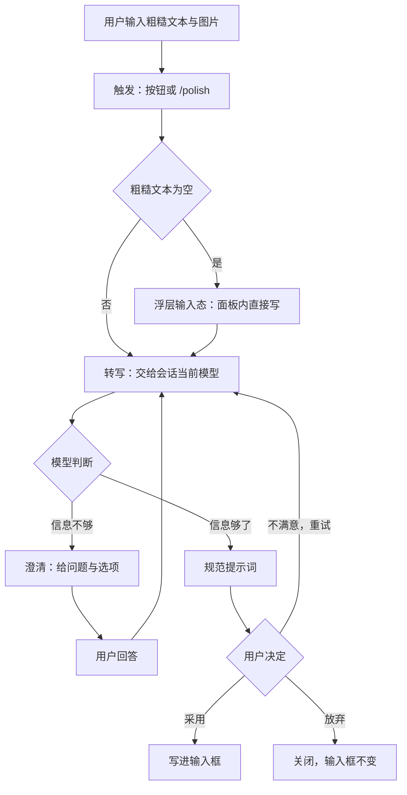

# 001 领域模型

这份文档命名 `/polish` 里的概念，以及每个概念守的规则。`index.js`、`client.js`、浮层文案和其余文档都用这些词，不用别的。边界由 [000 原则](000-philosophy.md) 决定。

## 流程

用户要么点输入框工具条上的按钮，要么在输入框里敲 `/polish`。插件拿到那一刻的粗糙文本和输入框里的图片，交给模型转写。模型判断信息不够就反问，够了就给出规范提示词。用户在浮层里看到规范提示词，决定采用还是放弃。

## 概念表

| 概念 | 定义 | 守住的规则 |
| --- | --- | --- |
| 粗糙文本 | 用户原本写的那句话或那段话 | 触发那一刻快照，之后用户再改输入框不影响本次转写 |
| 图片 | 输入框附件轨道里的 png/jpeg/webp/gif | 触发那一刻抓 `File` 句柄，澄清与重试复用同一批 |
| 触发 | 用户发起一次转写的动作 | 两个入口：工具条的按钮、`/polish` 命令 |
| 转写 | 一次 `ctx.llm` 调用，把粗糙文本变成问题或规范提示词 | 跑在**会话当前模型**上；不带 `sessionId`、不带 `purpose`、不带 `reasoningEffort` |
| 追问预算 | 本次尝试还能问几轮澄清，0 到 3 | 「不满意，重试」归零；出错重试不归零 |
| 澄清 | 模型认为信息不够时给出的一组问题，每个带 2 到 3 个选项，也允许自由填 | 一轮展示完，用户答完继续转写 |
| 规范提示词 | 模型给出的、脱离上下文仍能独立成立的提示词 | 覆盖任务与目标、输出格式与验收标准、缺口标注、不发明需求四项 |
| 假设 | 模型在规范提示词之外标出的、它自己补的信息 | 附在规范提示词下方一起展示 |
| 浮层 | 输入框正上方那块预览面板 | 只有一个；不渲染在对话流里 |
| 采用 | 把规范提示词整段写进输入框 | 只调 `setDraft`，从不提交 |

## 聚合

浮层状态是唯一的聚合根：每个会话一份，持有粗糙文本、图片句柄、澄清记录、追问预算、规范提示词、假设、错误，以及这次请求的 `AbortController`。整体替换，不做字段级修改；写下去的是新对象，订阅者按对象身份判断新旧。

不属于概念的东西：

| 东西 | 为什么不是概念 | 怎么接入 |
| --- | --- | --- |
| 会话 | 宿主的概念，插件只读它 | `sessionId` 由 Client 随请求带上；Host 用它读上下文与模型选择 |
| 模型 | 宿主配置的，不是插件的东西 | 按 `{ provider, model }` 从会话解析，交给 `ctx.llm.stream` |
| 附件存储 | 宿主的 | 图片经 `ctx.attachments.admitPromptContent` 准入后才变成模型能读的引用 |
| 用户 | — | 点按钮或敲命令 |

## 术语表

| 术语 | 中文 | 含义 |
| --- | --- | --- |
| `source` | 粗糙文本 | 浮层状态里本次要转写的原文 |
| `transcript` | 澄清记录 | 已经问过并得到回答的轮次，只增不减 |
| `rounds` | 追问预算 | 本次尝试已花掉的轮次；与 `transcript` 分开，重试时归零 |
| `prompt` | 规范提示词 | 模型给出的成品 |
| `assumptions` | 假设 | 模型自己补的信息，展示在成品下方 |
| `imageFiles` | 图片句柄 | 触发时抓到的浏览器 `File` 数组 |
| `controller` | 请求句柄 | 这次请求的 `AbortController` |
| `no-vision` | 不支持图片 | 会话当前模型没声明 `image` 输入时的错误码 |
| `round-limit` | 问满轮次 | 预算用尽模型仍在追问时的错误码 |
| `polish/no-model` | 没有可用模型 | 三个来源都没给出路由时的错误码 |

## 枚举值

### 浮层状态

| 组 | 取值 |
| --- | --- |
| 浮层状态 | `idle` · 未触发或已关闭 · `input` · 面板内可编辑的输入态 · `drafting` · 已发出请求等待模型 · `clarifying` · 展示追问 · `review` · 展示成品 · `error` · 展示失败原因与可编辑原文 |

一次转写有两个终态，都回到 `idle`：采用（已写进输入框）、放弃（用户主动关闭）。

### 错误码

| 组 | 取值 |
| --- | --- |
| 错误码 | `polish/empty-input` · 粗糙文本为空 · `polish/no-model` · 三个模型来源都没有可用路由 · `polish/no-vision` · 会话当前模型不接受图片 · `polish/bad-image` · 图片读不出或准入被拒 · `polish/bad-output` · 模型返回不是可解析的 JSON 结构 · `polish/llm-error` · 模型报错或结束原因异常 · `polish/timeout` · 超过 60 秒 · `polish/aborted` · 调用方中止 · `polish/transport-error` · HTTP 非 2xx 或 fetch 失败 · `polish/bad-request` · 请求体不是 JSON 或超过额度 · `polish/round-limit` · 问满 3 轮仍在追问 |

### 澄清回答

| 组 | 取值 |
| --- | --- |
| 多选标记 | `multi` · 转写提示词里要求的拼写 · `multiSelect` · 宿主提问组件的拼写 · 两者都缺失 · 按单选处理 |
