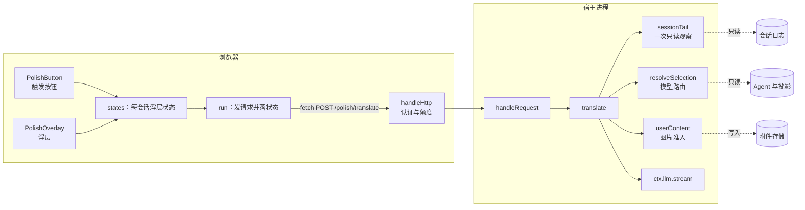
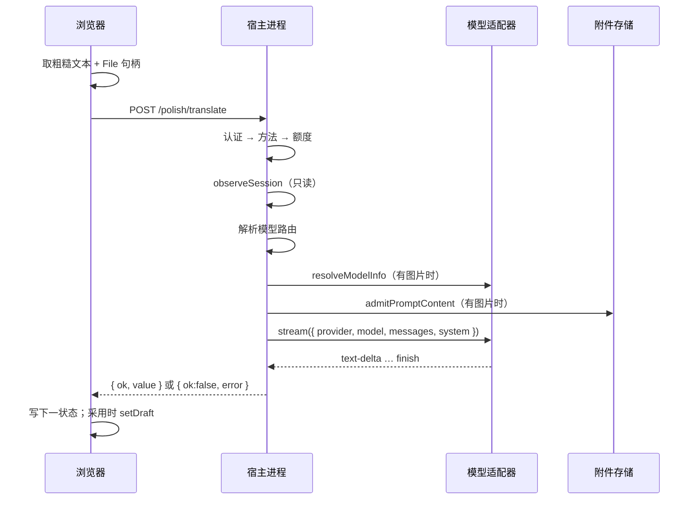

# 007 架构

这份文档把 [001 领域模型](001-domain.md) 的概念映射到两个文件里的函数与组件，并给出依赖规则和两张索引表。先读「核心图」与「数据流」，再看「核心对象」和「依赖规则」；「模块」和「测试」两张表当索引用，改代码前在这里找位置。上限与准入见 [002 规则与权限](002-rules.md)，阶段见 [003 生命周期](003-lifecycle.md)，界面见 [005 界面](005-interface.md)。

整个插件就两个源文件：`index.js` 跑在宿主进程里，`client.js` 跑在浏览器里。

## 目录结构

仓库根目录就是可安装的 bundle 本体。

```
<仓库根>/
├── AGENTS.md          # 文档索引 + 开发规则
├── package.json       # bundle 清单：exports、dsh.bundle.patch、dsh.client
├── cordis.patch.yml   # 插件行，一行 Host 注册
├── index.js           # Host 半边
├── client.js          # Client 半边
├── docs/
├── test/
└── tmp/               # 临时文件（规则 D1，已 gitignore）
```

## 核心图



## 数据流



## 核心对象

### `translate()` — Host 的转写管线

拥有一次转写的全部步骤，顺序固定：空文本判定 → 图片结构过滤 → 只读观察 → 模型解析 → 图片能力判定 → 图片准入 → 拼用户轮 → 调模型 → 解析 JSON。

它不碰会话（只读不写）、不碰文件系统、不写日志。所有失败都以带 `code` 的 `Error` 抛出，由 `handleRequest` 转成 `{ ok:false, error }`。

### `resolveSelection()` — 模型路由

三个来源按序取第一个可用的：`liveSelection`（live Agent 的 `model.current()`）、`sessionTail` 返回的会话记录、`agentDefaultModel.currentSelection()`。每个来源都过 `usableSelection`，只留 `{ provider, model }`。

它不写回任何东西：不调 `model.select()`，不调 `saveSelection()`。

### `sessionTail()` — 一次只读观察

一次 `observeSession(sessionId, { projectionMode: 'all', signal })` 同时产出两样东西：尾部最多 8 条消息的上下文，和 `projections.values.modelSelection` 的 `next ?? lastUsed`。投影读取单独兜错，投影坏了不牵连已经读到的上下文。

### `handleHttp()` — 唯一入口

认证 → 方法 → 读体 → 额度 → 分派。四道闸都在调模型之前。

### `states` — Client 的浮层状态

`Map<sessionId, state>` 加一个订阅者集合。`readState`/`writeState` 是唯一读写口；每次写入整对象替换，组件按对象身份判断响应是否过期。

### `PolishOverlay` — 浮层组件

按 `state.phase` 分支渲染，从只读区取 `prompt`，从 `questions` 取澄清题目。它唯一的写动作是 `adopt` 里的 `inputActions.setDraft`。

## 调用桥

Host 与 Client 之间只有一条 HTTP 路由：`POST /polish/translate`，由插件自己注册在 `webServer` 上。Client 用相对路径 `fetch('polish/translate')`，解析方式与宿主的 `/api` 通道一致。

宿主另外两条通路在本插件里用不了：

| 通路 | 为什么不用 |
| --- | --- |
| `ctx.connection.rpc.handle` | 它把物理路由挂在 connection 服务自己的 ctx 上（`dsh-client-connection/lib/index.js` 里 `register(this.ctx, …)`），而那个 ctx 只注入 `credentials` 与 `webRuntime`，不含 `webServer`。任何调用方都会撞 `cannot get property "webServer" without inject`；给本插件加 `webServer` 无效，owner 不是本插件 |
| `ctx.connection.rpc.intercept('/api', …)` | API Gateway 已经占了 `/api` 的唯一 interceptor，第二次注册直接抛错 |
| Typert 生成的 `ctx.remote.*` | 需要生成产物与构建步骤，本仓库是普通 JS |

桥只承载「请求转写」与「返回结果」两类消息，不做流式渲染。在途请求的作废靠 `AbortController` + 状态对象身份比较，不额外造请求 id。

## 依赖规则

### 谁能 import 谁

| 文件 | 允许 | 实际 |
| --- | --- | --- |
| `index.js` | Node 内建与相对路径 | 零 bare import；不 import 任何 `@deepseek-ai/*` 包 |
| `client.js` | 模块加载器提供的 `require` | 只有 `require('react')`，是浏览器模块表查询，不是包解析 |
| 两个文件之间 | 无 | 不互相 import，只通过 `POST /polish/translate` 通信 |
| 测试 | 相对路径 import 两边 | 不与生产代码共享依赖 |

Host 用到的宿主能力全部从 `ctx` 上取，不 import 宿主包。这是零依赖的由来，也是这个 bundle 能在任意 profile 上加载的原因。

| 能力 | 接口 | 来源包 |
| --- | --- | --- |
| 注册斜杠命令 | `ctx.commands.register({ name, description, input, handler })` | `@deepseek-ai/dsh-commands` |
| 直接调模型 | `ctx.llm.stream(options)` | `@deepseek-ai/dsh-llm` |
| 查模型能力 | `ctx.llm.resolveModelInfo(provider, model, signal)` | `@deepseek-ai/dsh-llm` |
| 取会话当前模型 | `ctx.get('agents').get(sessionId).model.current()`（软取，不进 `inject`） | `@deepseek-ai/dsh-agent` |
| 取部署默认模型 | `ctx.agentDefaultModel.currentSelection()` | `@deepseek-ai/dsh-agent-default-model` |
| 只读会话上下文与记录的模型 | `ctx.sessionQuery.observeSession(sessionId, { projectionMode: 'all' })` | `@deepseek-ai/dsh-session-query` |
| 注册自有 HTTP 路由 | `ctx.webServer.register({ kind, path, handler })` | `@deepseek-ai/dsh-host-webserver` |
| 路由认证判定 | `ctx.connection.requestRejection({ headers })` | `@deepseek-ai/dsh-client-connection` |
| 图片准入 | `ctx.attachments.admitPromptContent(parts)` | 宿主的附件服务 |
| 写入输入框 | `InputActions.setDraft(text)` | `@deepseek-ai/dsh-client-ui-conversation` |
| 浮层挂载点 | slot `conversation.input.dock` | 同上 |
| 触发按钮挂载点 | slot `conversation.input.right` | 同上 |

### 每种状态只有一个写者

| 状态 | 唯一写者 | 其它角色 |
| --- | --- | --- |
| 浮层状态 | `client.js` 的 `writeState` | 组件只读；Host 完全不知道它 |
| 输入框草稿 | `client.js` 的 `adopt` | 只调一次 `setDraft`，从不提交 |
| 会话日志 | 宿主 | 插件只 `observeSession` 读 |
| 模型选择 | 用户的模型选择器 | 插件只读 `model.current()` 与投影 |
| 附件存储 | `ctx.attachments.admitPromptContent` | 插件只把准入后的引用塞进消息 |

## 模块

| 路径 | 职责 |
| --- | --- |
| `index.js` | Host 半边：注册 `/polish` 命令与自有 HTTP 路由，解析会话当前模型，读只读上下文，准入图片，调 `ctx.llm.stream`，把结果归一成 `{ ok, value }` 或 `{ ok:false, error }` |
| `client.js` | Client 半边：注册触发按钮与浮层两个 slot，维护每会话浮层状态机，采集并编码输入框图片，发 HTTP 请求，采用时写 `setDraft` |

## 测试

| 测试 | 覆盖什么 |
| --- | --- |
| `test/host.test.js` | 用假 ctx 调 `apply(ctx)`，再调真实注册出来的 HTTP handler：命令定义（`recordInput: false`、`input.attachments: true`、handler 不带文本）、路由挂载、401/403/405/400/413、错误码映射、提示词拼装、只读上下文与投影降级、模型解析三个来源的优先级与只读约束、图片通路（准入顺序、畸形拒绝、能力判定、额度随体积增长） |
| `test/client.test.js` | 装 `window.__ModuleLoader__` 后动态 import `client.js`，经工厂返回的 `__internals` 驱动纯状态机：命令解析、答案序列化、迁移表每一行、错误映射、`setDraft` 只写不提交（含源码级断言）、图片采集与提交后交还 |

两个文件合计 103 项，全部用 Node 内置 `node:test`，零依赖。`__internals` 是刻意的测试缝，运行时不读它。

改 Host 半边后必须重启 dsh 才生效；改 Client 半边硬刷新页面。

## 持久化

插件自己不留任何持久状态。

| 存储 | 存什么 | 谁写 |
| --- | --- | --- |
| 会话日志 | 会话事件与 `modelSelection` 投影 | 宿主。插件只读 |
| 附件存储 | 准入后的图片字节，内容寻址、自动去重 | `ctx.attachments.admitPromptContent`。插件只传字节 |
| 浏览器内存 | 浮层状态、命令行、图片句柄 | `client.js`。刷新页面即清空 |

没有数据库表，没有键值记录，也没有配置文件写入。

## 对外接口

### 命令

| 字段 | 值 |
| --- | --- |
| `name` | `polish` |
| `description` | 把粗糙提示词转写成规范提示词，确认后写入输入框 |
| `input.hint` | 粗糙提示词（留空则用输入框当前内容） |
| `input.attachments` | `true` |
| `recordInput` | `false` |
| handler | 返回 `{ kind: 'success' }`，不带任何文本 |

### HTTP 路由

`POST /polish/translate`，`kind: 'exact'`。

| 项 | 值 |
| --- | --- |
| 认证 | `ctx.connection.requestRejection({ headers })`，不过得 401 或 403 |
| 方法 | 只接受 `POST`，其余 405 |
| 请求体 | `{ sessionId?, text, transcript, rounds?, feedback, images? }` |
| 额度 | `64 KiB` + 本次图片 base64 字节，硬顶 300 MiB |
| 成功 | 200，`{ ok:true, value:{ kind:'questions', questions } \| { kind:'prompt', prompt, assumptions } }` |
| 业务失败 | 200，`{ ok:false, error:{ code, message, details } }` |

业务失败也走 200：`ok` 已经区分两类结果，HTTP 状态只表示传输层。完整字段与错误码见 [002 规则与权限](002-rules.md)。

### Slot

| Slot | 组件 | 位置 |
| --- | --- | --- |
| `conversation.input.right` | `PolishButton` | 输入框工具条，模型选择器左侧 |
| `conversation.input.dock` | `PolishOverlay` | 输入框卡片上方 |

Client 半边声明 `inject: ['slots']`；`commandUi` 走 `ctx.inject(['commandUi'], …)` 延迟取。

## 不变量

1. 浮层是唯一的输出展示面：结果不进对话流、不进会话历史。
2. 输入框只在「采用」时被写一次，且是整段替换。
3. 任何失败都不清空用户已输入的粗糙文本。
4. 插件自己不写任何文件。唯一的落盘是图片经 `ctx.attachments.admitPromptContent()` 写进部署的附件存储（内容寻址、自动去重），与用户正常发一条带图消息走同一条路径。
5. 模型路由的三个来源全部只读，插件不写回任何选择。

## 配置热更新

插件不声明 Config，没有热更新路径。

| 改了什么 | 怎么生效 |
| --- | --- |
| `index.js` | 重启 dsh（ESM 模块缓存，重装 bundle 也不会换模块） |
| `client.js` | 浏览器硬刷新 |
| `cordis.patch.yml` | 重装 bundle 并重启 dsh |
| `package.json` | 重装 bundle 并重启 dsh |
